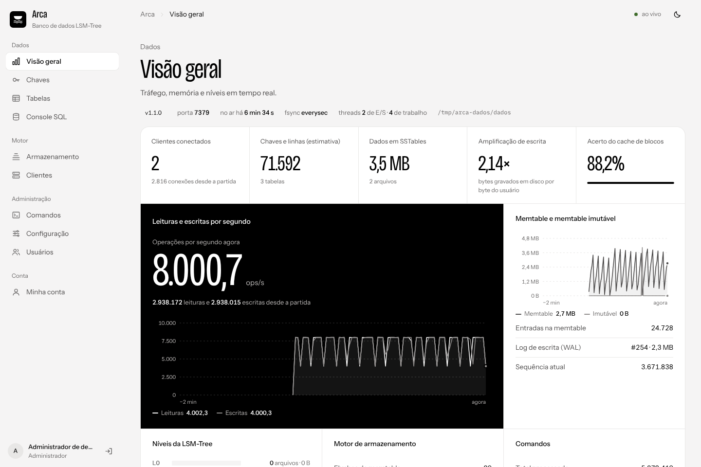
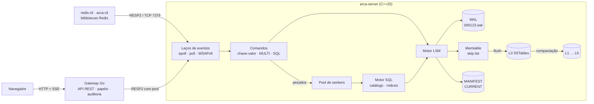
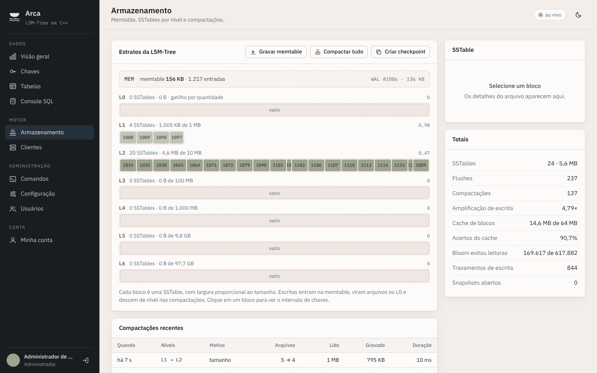
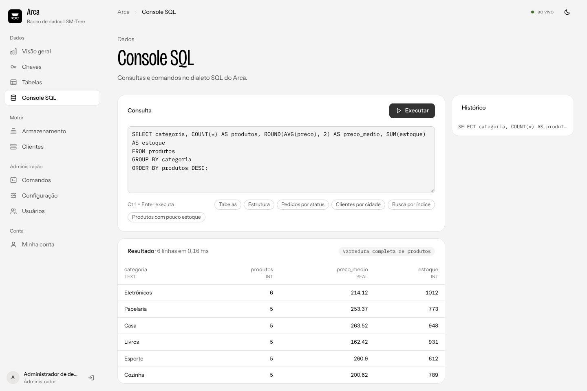
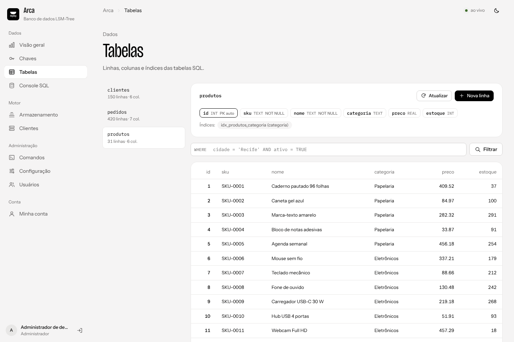
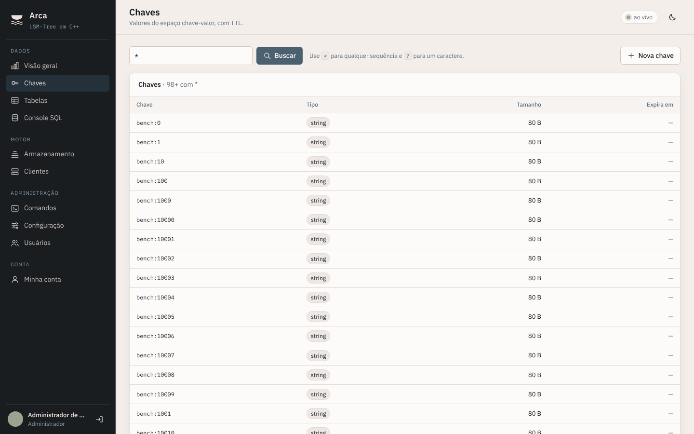
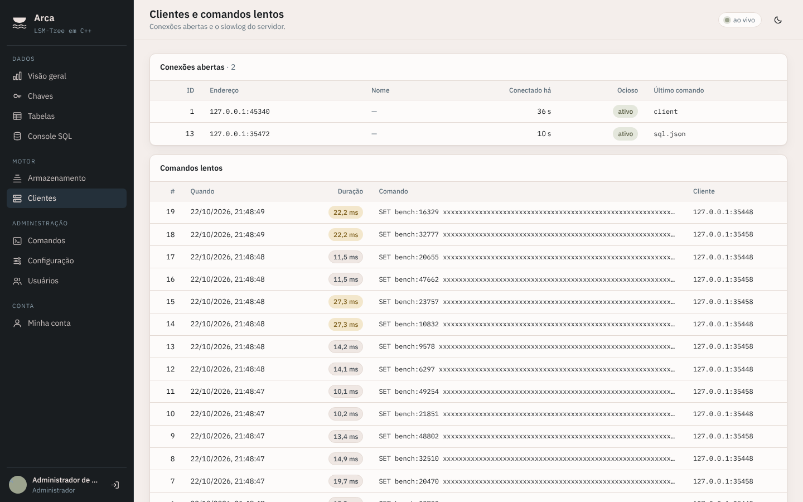
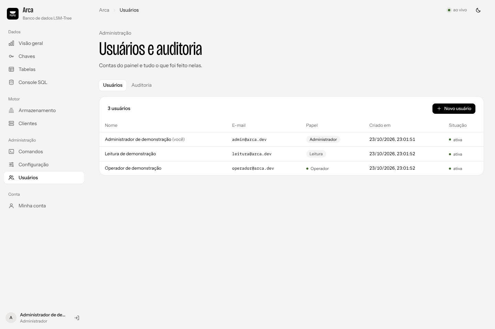
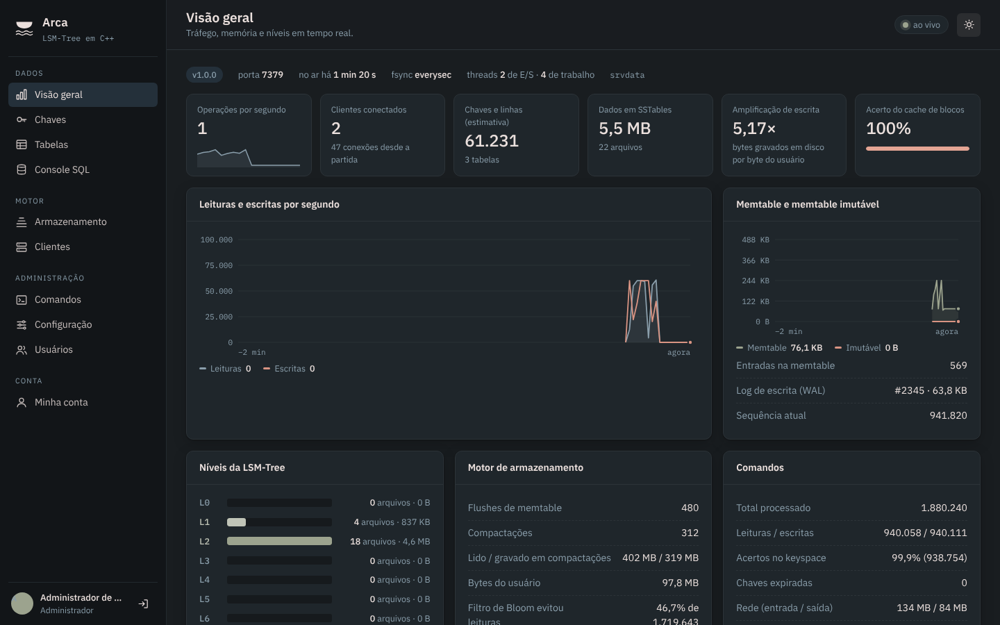

<p align="center">
  
</p>

<h1 align="center">Arca<br><sub><sup><sup><sub>Copyright (©) 2026 Erik Pimenta</sub></sup></sup></sub></h1>

<p align="center">
  Banco de dados com LSM-Tree escrito em C++20: guarda chave-valor e tabelas com SQL em arquivos binários próprios, fala o protocolo do Redis por TCP e aguenta queda de energia sem perder o que já foi confirmado.<br>
  Pronto para usar, estudar ou adaptar.
</p>

<p align="center">
  C++20 · CMake · biblioteca padrão (&lt;thread&gt;, &lt;mutex&gt;, &lt;shared_mutex&gt;, &lt;atomic&gt;) · epoll / poll · RESP2 · Go 1.24 · React 18 · TypeScript · Vite · Docker Compose
</p>

---

> **Manual completo:** [`Manual-Arca.pdf`](Manual-Arca.pdf) explica a instalação, o servidor, os comandos, o SQL, o painel, a API, a configuração, a operação e a solução de problemas, passo a passo (cópia em [`docs/`](docs/Manual-Arca.pdf)).

> **Banco de dados:** [`Banco-de-Dados-Arca.pdf`](Banco-de-Dados-Arca.pdf) descreve a arquitetura de armazenamento que a aplicação segue: LSM-Tree, formato do WAL, das SSTables e do MANIFEST, codificação das chaves e das linhas, compactação e recuperação.

<p align="center">
  
</p>

## O que a Arca faz

- **Motor LSM-Tree próprio:** escritas vão para o log (WAL) e para uma memtable em skip list; quando ela enche vira uma SSTable imutável no nível 0, e a compactação em segundo plano desce os dados pelos níveis L1 a L6.
- **Arquivos binários com checksum:** WAL em blocos de 32 KB, SSTables com blocos de 4 KB, chaves com prefixo compartilhado, índice, filtro de Bloom e CRC32C em cada bloco. O MANIFEST guarda o histórico de versões.
- **Recuperação após queda:** na abertura o banco relê o MANIFEST, reaplica os logs que ainda não viraram SSTable e descarta só a cauda incompleta do último registro.
- **Concorrência:** escritores entram numa fila com group commit (um líder grava o lote de todos), leitores não travam a memtable, versões são imutáveis e compartilhadas, e o cache de blocos e o de tabelas usam mutex por fatia e `shared_mutex`.
- **Snapshots MVCC:** cada escrita recebe um número de sequência; leituras e varreduras enxergam um retrato consistente e a compactação preserva o que algum snapshot ainda vê.
- **Servidor TCP assíncrono:** laços de eventos com epoll (Linux), poll (macOS) ou WSAPoll (Windows), pipelining, e um pool de workers para comandos pesados sem travar a rede.
- **Compatível com o Redis:** fala RESP2, então `redis-cli` e bibliotecas de Redis funcionam. Strings, TTL, contadores, `SCAN`, `MULTI/EXEC`, `INFO`, `SLOWLOG`, `CLIENT LIST`.
- **Tabelas com SQL:** `CREATE TABLE`, índices secundários, `INSERT`, `SELECT` com `WHERE`, `GROUP BY`, `ORDER BY`, agregações e `EXPLAIN`, `UPDATE`, `DELETE`, `ALTER TABLE ADD COLUMN`, tudo gravado na mesma LSM-Tree.
- **Painel web e API:** gateway em Go com API REST, eventos em tempo real (SSE), papéis e auditoria; painel em React para ver níveis, SSTables, chaves, tabelas e rodar SQL.
- **Ferramentas:** `arca-cli` (console com SQL), `arca-bench` (carga), `arca-inspect` (abre SST, WAL e MANIFEST) e uma biblioteca para embutir o motor no seu programa.

## Arquitetura



| Processo | Comando | Responsabilidade |
|---|---|---|
| Servidor | `arca-server` | Rede, comandos, SQL, expiração de chaves e o motor LSM com as threads de compactação e de sincronização do WAL |
| Gateway | `arca-gateway` | API REST, sessões, papéis, auditoria, métricas por SSE e entrega do painel |
| Painel | `web/` | Interface em React servida pelo gateway |

### Caminho de uma escrita

1. O comando chega pelo laço de eventos, é decodificado do RESP e vira um lote (`WriteBatch`).
2. O lote entra na fila de escritores. O primeiro da fila vira líder, junta os lotes que estão esperando e grava tudo de uma vez no WAL.
3. Com `appendfsync always` o líder faz `fsync` antes de responder; com `everysec` uma thread sincroniza a cada segundo.
4. O lote é aplicado na memtable e só então a sequência é publicada, então nenhum leitor vê um lote pela metade.
5. Quando a memtable passa de `write-buffer-size`, ela vira imutável, um log novo começa e a thread de fundo grava a SSTable no L0.
6. Quando o L0 junta 4 arquivos, ou um nível passa do limite de bytes, a compactação mistura os arquivos com o nível de baixo, descarta versões que ninguém mais enxerga e grava SSTables novas. O MANIFEST registra a troca de forma atômica.

### Caminho de uma leitura

Memtable atual → memtable imutável → SSTables do L0 da mais nova para a mais antiga → um arquivo por nível a partir do L1 (busca binária pelo intervalo de chaves). Em cada SSTable o filtro de Bloom evita a leitura do disco quando a chave não está lá, e o cache de blocos guarda os blocos mais usados.

<p align="center">
  
</p>

## Como rodar

Você só precisa do **Docker** com Docker Compose.

**Windows:** dê dois cliques em `iniciar.cmd`.

**Linux ou macOS:**

```bash
./iniciar.sh
```

Na primeira vez o script cria o arquivo `.env` com uma senha aleatória para o servidor, compila as imagens (servidor em C++, gateway em Go e painel) e abre **http://localhost:8080**.

| Endereço | O que é |
|---|---|
| http://localhost:8080 | Painel |
| http://localhost:8080/api/openapi.json | Esquema OpenAPI da API |
| localhost:7379 | Servidor Arca (RESP2), com a senha do `.env` |

Para rodar sem o script:

```bash
cp .env.example .env        # troque ARCA_PASSWORD
docker compose up -d --build
```

### Sem Docker

Precisa de um compilador C++20 (GCC 11+, Clang 14+ ou Visual Studio 2022) e CMake 3.20+. O núcleo usa só a biblioteca padrão.

```bash
cmake -S . -B build -DCMAKE_BUILD_TYPE=Release
cmake --build build --parallel
./build/arca-server config/arca.conf
```

No Windows: `cmake -S . -B build` e `cmake --build build --config Release`; os executáveis ficam em `build\Release\`.

Para o painel sem Docker: `cd gateway && go run ./cmd/arca-gateway` (variáveis `ARCA_ADDR` e `ARCA_PASSWORD`) e, em outro terminal, `cd web && npm install && npm run build`.

## Contas de demonstração

Todas usam a senha **`Arca@2026`**. Elas existem só para testes, para qualquer pessoa entrar logo depois de baixar o projeto. Os nomes são fictícios e os e-mails usam o domínio de exemplo `arca.dev`.

| Papel | E-mail | O que pode fazer |
|---|---|---|
| Administrador | `admin@arca.dev` | Tudo, incluindo usuários, configuração, auditoria e console de comandos |
| Operador | `operador@arca.dev` | Ler e gravar chaves, linhas e SQL, gravar a memtable, compactar e criar checkpoints |
| Leitura | `leitura@arca.dev` | Só consultar |

Na primeira subida o gateway cria as tabelas `clientes`, `produtos` e `pedidos` e algumas chaves de exemplo para o painel não abrir vazio. Para usar de verdade, suba com `ARCA_SEED=false` num volume vazio e troque as senhas.

## Usando o servidor

Qualquer cliente de Redis funciona:

```bash
redis-cli -p 7379 -a "$ARCA_PASSWORD" SET sessao:42 ativo EX 3600
redis-cli -p 7379 -a "$ARCA_PASSWORD" INCR contador:visitas
redis-cli -p 7379 -a "$ARCA_PASSWORD" SCAN 0 MATCH 'sessao:*' COUNT 100
```

O `arca-cli` reconhece SQL direto e mostra o resultado em tabela:

```sql
CREATE TABLE contas (id INT PRIMARY KEY AUTOINCREMENT, titular TEXT NOT NULL, cidade TEXT, saldo REAL DEFAULT 0);
CREATE INDEX idx_cidade ON contas (cidade);
INSERT INTO contas (titular, cidade, saldo) VALUES ('Ana', 'Rio', 120.5), ('Bruno', 'Niterói', 80);
SELECT cidade, COUNT(*) AS contas, SUM(saldo) AS total FROM contas GROUP BY cidade ORDER BY total DESC;
EXPLAIN SELECT * FROM contas WHERE cidade = 'Rio';
UPDATE contas SET saldo = saldo + 10 WHERE id = 1;
```

Por outros clientes, mande o SQL como argumento: `SQL "SELECT ..."` (resposta em arrays) ou `SQL.JSON "SELECT ..."` (resposta em JSON).

| Grupo | Comandos |
|---|---|
| Conexão | `PING` · `ECHO` · `AUTH` · `HELLO` · `SELECT 0` · `QUIT` · `CLIENT ID/SETNAME/GETNAME/LIST` |
| Strings | `GET` · `SET` (`EX` `PX` `EXAT` `PXAT` `NX` `XX` `GET` `KEEPTTL`) · `SETNX` · `SETEX` · `PSETEX` · `GETSET` · `GETDEL` · `MGET` · `MSET` · `APPEND` · `STRLEN` · `INCR` · `DECR` · `INCRBY` · `DECRBY` · `INCRBYFLOAT` |
| Chaves | `DEL` · `UNLINK` · `EXISTS` · `TYPE` · `RENAME` · `RENAMENX` · `EXPIRE` · `PEXPIRE` · `EXPIREAT` · `PEXPIREAT` · `TTL` · `PTTL` · `PERSIST` · `SCAN` · `KEYS` · `DBSIZE` · `FLUSHDB` |
| Transações | `MULTI` · `EXEC` · `DISCARD` |
| SQL | `SQL` · `SQL.JSON` · `SQL.TABLES` |
| Servidor | `INFO` · `CONFIG GET/SET` · `SLOWLOG GET/LEN/RESET` · `SAVE` · `BGSAVE` · `LASTSAVE` · `TIME` · `SHUTDOWN` |
| Arca | `ARCA.STATS` (JSON) · `ARCA.FLUSH` · `ARCA.COMPACT` · `ARCA.CHECKPOINT [nome]` · `ARCA.SNAPSHOT BEGIN/END` · `ARCA.SCANJSON` |

| Tela | |
|---|---|
|  |  |
|  |  |
|  |  |

## Linha de comando

```bash
arca-server config/arca.conf --port 7379 --dir dados     # sobe o servidor
arca-cli -a senha                                         # console interativo (SQL e comandos)
arca-cli -a senha SQL "SHOW TABLES"                       # um comando só
arca-bench -c 8 -n 100000 -P 16 -a senha                  # carga de SET e GET com pipelining
arca-inspect sst dados/000042.sst --tudo                  # propriedades, verificação e conteúdo de uma SSTable
arca-inspect wal dados/000043.wal                         # lotes gravados no log
arca-inspect manifest dados/MANIFEST-000044               # histórico de versões e arquivos por nível
arca-inspect check dados                                  # confere o checksum de todas as SSTables
```

## API

Todas as rotas ficam em `/api`, respondem JSON e exigem `Authorization: Bearer <token>`, exceto login, saúde e o esquema OpenAPI. Erros sempre no mesmo formato: `{ "code": "...", "message": "...", "fields": { "campo": "mensagem" } }`.

| Grupo | Rotas principais |
|---|---|
| Acesso | `POST /auth/login` · `POST /auth/logout` · `GET /auth/me` · `PUT /auth/me/password` |
| Monitoramento | `GET /overview` · `GET /events` (SSE) · `GET /storage` · `GET /clients` · `GET /slowlog` · `GET /health` |
| Chaves | `GET /keys` · `GET`, `PUT` e `DELETE /keys/value` · `POST /keys/expire` |
| Tabelas e SQL | `GET /tables` · `GET`, `POST`, `PUT` e `DELETE /tables/{nome}/rows` · `POST /sql` |
| Operação | `POST /storage/flush` · `POST /storage/compact` · `POST /storage/checkpoint` |
| Administração | `POST /command` · `GET` e `PUT /config` · `GET`, `POST`, `PATCH` e `DELETE /users` · `GET /audit` |

```bash
TOKEN=$(curl -s -X POST localhost:8080/api/auth/login -H 'Content-Type: application/json' \
  -d '{"email":"operador@arca.dev","password":"Arca@2026"}' | jq -r .token)

curl -s -X POST localhost:8080/api/sql -H "Authorization: Bearer $TOKEN" \
  -H 'Content-Type: application/json' -d '{"query":"SELECT * FROM produtos ORDER BY preco DESC LIMIT 5"}'
```

## Configuração

O servidor lê um arquivo como [`config/arca.conf`](config/arca.conf), depois as variáveis `ARCA_*` e por último os argumentos `--nome valor`.

| Parâmetro | Padrão | Para que serve |
|---|---|---|
| `bind` / `port` | `127.0.0.1` / `7379` | Endereço e porta TCP |
| `dir` | `dados` | Pasta do banco (checkpoints vão para `checkpoints/` ao lado) |
| `requirepass` | vazio | Senha exigida pelo `AUTH` (variável `ARCA_PASSWORD`) |
| `io-threads` / `worker-threads` | `2` / `4` | Laços de rede e threads para comandos pesados |
| `appendfsync` | `everysec` | `always` (fsync a cada escrita), `everysec` ou `no` |
| `write-buffer-size` | `4mb` | Tamanho da memtable antes de virar SSTable |
| `max-file-size` | `2mb` | Tamanho alvo de cada SSTable gerada na compactação |
| `level1-max-bytes` | `10mb` | Limite do L1; cada nível seguinte é 10 vezes maior |
| `block-cache-size` | `64mb` | Cache de blocos das SSTables |
| `bloom-bits-per-key` | `10` | Bits por chave no filtro de Bloom (cerca de 1% de falso positivo) |
| `maxclients` / `timeout` | `10000` / `0` | Limite de conexões e segundos de inatividade (0 desliga) |
| `slowlog-log-slower-than` | `10000` | Microssegundos para um comando entrar no slowlog |

No gateway: `ARCA_ADDR`, `ARCA_PASSWORD`, `ARCA_HTTP_ADDR` (`:8080`), `ARCA_WEB_DIR`, `ARCA_SEED` e `ARCA_SESSION_HOURS`.

## Embutindo e estendendo

O motor é uma biblioteca (`arca_engine`) com a API em [`include/arca/db.hpp`](include/arca/db.hpp):

```cpp
#include "arca/db.hpp"

std::unique_ptr<arca::DB> db;
arca::DB::Open(arca::Options(), "meu-banco", &db);
arca::WriteBatch lote;
lote.Put("produto:1", "Caderno");
lote.Delete("produto:2");
db->Write(arca::WriteOptions(), &lote);
auto retrato = db->GetSnapshot();
auto it = db->NewIterator(arca::ReadOptions());
for (it->Seek("produto:"); it->Valid() && it->key().starts_with("produto:"); it->Next()) { }
```

O exemplo completo está em [`examples/embedded.cpp`](examples/embedded.cpp).

| Para | Onde mexer |
|---|---|
| Criar um comando novo | Escreva a função em `src/server/commands.cpp` e registre o nome, a aridade e as flags em `CommandTable()` (`kHeavy` manda para o pool de workers) |
| Criar uma função SQL | Adicione o nome em `ValidateFunctions` e o cálculo em `Eval` (`src/sql/engine.cpp`) |
| Mudar a política de compactação | `VersionSet::Finalize` e `PickCompaction` em `src/db/version_set.cpp` |
| Trocar o formato das SSTables | `src/table/` (blocos, índice, Bloom e rodapé) |
| Nova rota da API | `gateway/internal/api/` |
| Nova tela | `web/src/pages/` e a lista de páginas em `web/src/App.tsx` |

## Segurança

| Regra | Como funciona |
|---|---|
| Servidor | Escuta só em `127.0.0.1` por padrão; com `requirepass`, nada além de `AUTH`, `HELLO`, `PING` e `QUIT` roda antes da senha |
| Dados em disco | CRC32C em cada registro do WAL e em cada bloco de SSTable; o `LOCK` impede dois processos no mesmo diretório |
| Senhas do painel | PBKDF2-SHA256 com 210 mil iterações e sal. Cinco erros seguidos bloqueiam a conta por 5 minutos |
| Sessões | Token aleatório de 32 bytes; no banco fica só o SHA-256, com expiração (padrão 12 horas) |
| Papéis | Leitura, Operador e Administrador, checados em cada rota |
| Auditoria | Logins, gravações, SQL de escrita, flush, compactação, checkpoint, configuração e usuários |
| Cabeçalhos | `Content-Security-Policy`, `X-Frame-Options: DENY`, `nosniff` e `Cache-Control: no-store` na API |
| Repositório | Nenhum dado pessoal real. Segredos só no `.env`, que fica fora do Git |

## Estrutura

```
LSM-Tree-Database-Server/
├── include/arca/            API pública do motor (DB, opções, lotes, iteradores)
├── src/
│   ├── util/                varint, CRC32C, arena, arquivos e trava de diretório
│   ├── db/                  WAL, memtable (skip list), versões, MANIFEST, compactação, recuperação
│   ├── table/               blocos, filtro de Bloom, cache LRU, SSTable (gravação e leitura)
│   ├── sql/                 analisador, catálogo, codificação de linhas e executor
│   ├── net/                 sockets, epoll/poll/WSAPoll e protocolo RESP2
│   └── server/              laços de eventos, workers, comandos, expiração e configuração
├── tools/                   arca-server, arca-cli, arca-bench e arca-inspect
├── examples/                motor embutido num programa C++
├── tests/                   testes do motor, do SQL e do servidor
├── gateway/                 API em Go (biblioteca padrão)
├── web/                     painel em React + TypeScript
├── config/                  arca.conf de exemplo
├── docs/                    manuais em PDF e imagens
├── Dockerfile
└── docker-compose.yml
```

## Testes

```bash
cmake -S . -B build && cmake --build build --parallel
./build/arca-tests                      # todos
./build/arca-tests Recuperacao          # só os que têm esse nome
cd gateway && go test ./...
cd web && npm ci && npm run build
```

Os testes do motor comparam milhares de escritas e remoções aleatórias com um `std::map` antes e depois da compactação e depois de reabrir o banco, cortam o fim do WAL para simular queda, conferem snapshots durante a compactação, escrevem de várias threads ao mesmo tempo e abrem um checkpoint como banco. Os do servidor sobem a Arca numa porta livre e testam comandos, expiração, `MULTI/EXEC`, pipelining, SQL e senha.

O workflow [`ci.yml`](.github/workflows/ci.yml) compila com GCC, Clang e MSVC, roda os testes com AddressSanitizer e ThreadSanitizer, testa o gateway e o painel e monta as imagens Docker.

## Licença

[MIT](LICENSE). Use, copie, altere e distribua à vontade. As fontes IBM Plex Sans e IBM Plex Mono do painel são distribuídas sob a [SIL Open Font License](web/OFL.txt).
